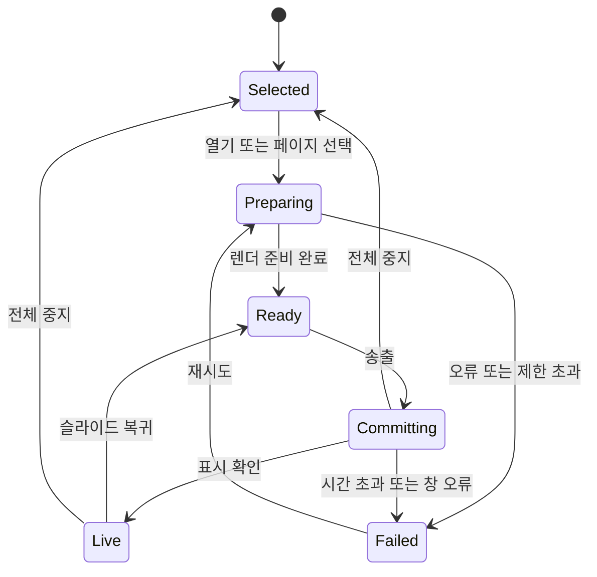

# URL 브라우저·PDF 송출 상세 설계

2026-10-12 (Asia/Seoul) · 상태: 로컬 구현·자동 회귀 검증 완료 / 실장비·사이트 수용 대기

연결: REQ-039 · ADR-016 · TASK-034~039 · TC-039. 초기 상세 설계를 후속 사용자 개발 요청에 따라 구현했다. 아래 설계 원안과 현재 구현의 차이는 15절과 검증 기록을 따른다. 자동 개발 검사를 실제 사이트·실장비 수용 통과로 해석하지 않는다.

## 1. 목표와 범위

현재 슬라이드와 이미지·영상 송출에 URL 브라우저와 PDF 페이지 송출을 추가한다. 자료 등록·선택·준비는 현재 메인 송출을 유지하고, 명시적 송출 명령으로만 전환한다. 현재 곡, 원곡, 콘티 사본, draft, 편집 이력은 그대로 유지한다.

| 1차 지원 | 구체적인 동작 |
| --- | --- |
| URL 자료 | 이름과 HTTP(S) 주소 등록·수정·삭제, 브라우저 준비, 뒤로/앞으로/새로고침, 확대·축소, 마우스·키보드 조작, 명시적 송출 |
| PDF 자료 | 관리 폴더로 원본 복사, 페이지 수·썸네일, 페이지 선택, 이전/다음, 회전, 전체 페이지 맞춤, 명시적 송출 |
| 전환·복구 | 준비/실제 송출 구분, 이전 화면 유지, 기존 슬라이드로 복귀, 전체 중지, 송출 창 재생성·장비 변경 |
| 저장·이동 | 자료 목록·PDF 원본 저장, 재시작, 전체 백업 왕복, 이전 작업 공간 보호 |

PPT/PPTX·Word·Excel·한글 직접 변환, 창/화면 공유, 웹페이지 위 자막 합성, 브라우저 탭 여러 개, 방송용 고프레임 캡처, DRM 재생 보장은 후속 범위다. 지원하지 않는 문서는 “PDF로 내보낸 뒤 등록해주세요”로 안내한다. URL 등록이 브라우저로 모든 파일 형식을 지원한다는 뜻은 아니다.

## 2. 현재 코드와 변경 근거

| 현재 근거 | 확인된 구조 | 설계에 미치는 영향 |
| --- | --- | --- |
| [미디어 빈](../../src/components/MediaBin.tsx), [mediaSlice](../../src/store/slices/mediaSlice.ts) | 이미지/영상 선택은 배경 변경, 오디오는 별도 활성화 | 기존 클릭 동작을 유지하고 URL/PDF만 준비→송출 흐름 추가 |
| [타입](../../src/types.ts), [스키마](../../shared/schema.ts) | MediaItem/Asset는 image/video/audio, OutputState는 layers | 기존 타입에 URL을 억지로 넣지 않고 자료·송출 소스 계약 추가 |
| [CompositeFrame](../../src/components/CompositeFrame.tsx) | 배경→슬라이드→공지→props→message 합성 | 외부 자료를 배경으로 취급하면 옛 가사가 겹치거나 PDF가 잘림 |
| [WindowManager](../../electron/services/windows.ts) | 역할/프레임/origin 검사, 화면별 version·snapshot·ready·applied | 외부 브라우저는 앱 역할을 갖지 않으며 준비/적용 상태 확장 필요 |
| [runtime](../../src/store/runtime.ts), [helpers](../../src/store/helpers.ts) | 중앙 구독에서 전체 Output/Stage 상태 발행 | 전환을 별도 임의 IPC로 우회하지 않고 중앙 상태 경로와 통합 |
| [SongSourcePreview](../../src/components/SongSourcePreview.tsx) | PDF.js worker, canvas, 페이지 렌더·정리 | PDF 렌더 유틸리티 재사용 가능. AI 작업 ID·base64 경로는 재사용하지 않음 |
| [Repository](../../electron/services/repository.ts) | workspace-v2, 직렬 저장, 등록 파일·참조 검사, 백업 | PDF를 실제 에셋·백업·정리 경로 모두에 추가해야 함 |
| [CSP](../../shared/content-security-policy.ts), [preload](../../electron/preload.ts) | frame-src none, 역할별 앱 브릿지 | 앱 CSP를 외부 사이트용으로 풀지 않고 별도 session 사용 |

코드 관찰 기준은 develop/db5d396의 로컬 작업 트리다. 동시 작업 중인 UI 파일은 구현 착수 시 재확인한다. 콘티 관리 등 기존 미커밋 변경도 현재 코드로 확인했으며 본 설계는 그 변경을 되돌리거나 포함 커밋하지 않는다. 현재 구현 계약은 [데이터·IPC 문서](데이터-저장-IPC-계약.md), [콘티 설계](콘티-보관함과-예배별-곡-사본.md)를 따른다.

## 3. 화면과 사용자 흐름

### 3.1 송출 자료 패널

기존 “미디어 빈” 제목을 “송출 자료”로 바꾸고 `파일 추가`, `URL 추가`, 종류 필터와 검색을 둔다. 기존 이미지/영상/오디오 카드의 실행 의미는 유지한다. 웹/PDF 카드에는 종류, 이름, 저장 상태, 준비/송출 배지를 표시한다. 카드 선택은 준비 패널만 열며 송출하지 않는다. 더블클릭도 송출하지 않는다.

```text
송출 자료                 [파일 추가] [URL 추가]
[전체] [이미지·영상] [오디오] [웹] [PDF]     검색
자료 목록                 준비 패널
주보.pdf                  주보.pdf · 준비 3/12
교회 홈페이지             페이지 썸네일 / 페이지 미리보기
                          [이전] [다음] [회전] [송출]
현재 송출: 찬양 A · 4장    준비: 주보.pdf · 3/12
```

패널 위치는 기존 ControlPanel의 미디어 영역과 인접한 준비 영역을 사용한다. 준비 화면을 여는 과정에서 편집 중인 텍스트·모달을 강제로 닫지 않는다. 작은 창에서는 준비 패널을 확장해 사용하되 현재 송출 표시와 전체 중지는 항상 접근 가능해야 한다.

### 3.2 URL 등록·준비·송출

1. URL 추가에서 이름(선택)과 주소를 입력한다. 이름이 없으면 호스트명으로 시작한다. 주소는 확정 등록 전 서버 측 URL 파서로 검증한다.
2. 스킴이 없는 주소는 https://를 붙이고, http://는 사용자가 명시한 경우 허용한다. 검색어 검색 기능은 제공하지 않는다.
3. 저장 성공 후 목록에 표시한다. 자동 접속은 하지 않는다. “열기”를 눌러 준비 브라우저를 만든다.
4. 준비 중 브라우저는 컨트롤의 준비 영역에서 직접 조작한다. 주소줄, 뒤로/앞으로, 새로고침, 로딩·오류, 확대 50~200%, 음소거 상태를 표시한다.
5. 준비 영역은 송출과 같은 화면 비율·논리 viewport를 사용한다. 작은 패널에는 잘라낸 임의 화면 대신 동일 화면의 축소 캡처를 보여주고, “브라우저 조작” 별도 창에서 같은 인스턴스를 직접 조작한다.
6. “송출” 시 같은 WebContentsView를 메인 창으로 옮긴다. 다시 loadURL하거나 두 번째 브라우저를 만들지 않는다. 주소줄/앱 버튼은 송출에 포함하지 않는다.
7. 송출 중 컨트롤 준비 영역은 해당 브라우저의 캡처 미리보기와 제한된 입력 전달을 제공한다. “실시간 조작”을 켠 경우 클릭·스크롤·일반 키 입력이 실제 송출에 적용됨을 명시한다. 기본은 조작 잠금이다.
8. 다른 URL로 이동할 때는 먼저 송출에서 해제해 준비 상태로 돌아가도록 안내한다. 송출 중 새 주소/뒤로/앞으로/새로고침은 비활성화한다. 링크 클릭으로 인한 탐색도 Main에서 차단하고 준비 상태에서 다시 시도하도록 안내한다. SPA의 화면 변화·자동 갱신까지 정지시키는 기능은 아니다.

등록 주소와 현재 탐색 주소를 구분한다. 로그인 후 주소나 리다이렉트는 등록 주소를 자동 덮어쓰지 않는다. “현재 주소로 저장”은 명시적 작업이며 민감 URL 정책을 다시 적용한다.

### 3.3 PDF 등록·준비·송출

1. 파일 선택에서 PDF를 지원한다. 원본 크기·헤더·파싱·페이지 수 확인과 첫 페이지 렌더를 마친 뒤 원본 복사+자료 등록을 확정한다. 여러 파일은 파일별 성공/실패를 반환한다.
2. 썸네일과 페이지 번호, 페이지 수를 표시한다. 최초는 1페이지, 재선택은 저장된 마지막 준비 페이지다. 전체 페이지가 검은 여백 안에 들어오는 contain이 기본이다.
3. 페이지 번호 클릭·이전/다음·회전은 준비 화면만 바꾼다. 90도 단위 회전을 지원하며 확대·스크롤·선택 영역 크롭은 1차 범위에서 제외한다.
4. 준비 페이지에서 “송출”을 누르면 해당 페이지 렌더가 완료된 후 전환한다.
5. 송출 중 “송출 이전/다음”은 현재 송출 PDF의 페이지를 변경한다. 썸네일 선택은 준비만 변경한다. 준비/현재 송출 번호를 나란히 표시한다.
6. 마지막 페이지에서 다음은 비활성화하며 첫 페이지로 자동 순환하지 않는다. 렌더 실패 시 이전 송출 페이지를 유지한다.
7. 원본은 관리 폴더에 복사하므로 외부 원본 이동·삭제에 영향받지 않는다. 재연결된 PDF는 새 hash로 페이지 수와 선택 번호를 다시 검증한다.

### 3.4 복귀·키보드·삭제

- “슬라이드로 복귀”는 현재 Store의 슬라이드·레이어를 다시 표시한다. 과거 레이어 사본을 덮어쓰지 않는다. 외부 자료 중 수동 편집·음량 변경도 유지된다.
- 기존 슬라이드 송출 명령은 외부 자료 모드를 끝내고 선택한 슬라이드를 송출한다. 기존 이미지/영상 실행도 외부 자료 모드를 끝내고 기존 레이어 합성으로 전환한다. 오디오 실행만으로는 화면 소스를 바꾸지 않는다.
- 기존 F2/전체 중지/Escape의 전체 중지 경로에 웹/PDF를 포함한다. 외부 자료·오디오·레이어·대기 작업을 모두 중지하고 검은 화면을 표시한다. 기존 지우기(F1 텍스트/F4 배경)는 슬라이드 레이어에만 작용하며 웹/PDF를 중단하려면 전체 중지/슬라이드 복귀를 사용한다. 버튼 설명에 적용 범위를 명시한다.
- 단축키 처리는 한 곳으로 통합한다. 일반 입력·모달·브라우저 텍스트 입력에는 슬라이드 이동키를 적용하지 않는다. PDF 준비에 focus가 있으면 준비 페이지, 송출 PDF 조작에 focus가 있으면 송출 페이지를 이동한다. 항상 전체 중지 버튼으로 빠져나갈 수 있어야 한다. native 브라우저가 focus를 가진 경우에도 Main의 before-input-event에서 F2를 처리해 전체 중지 경로로 보낸다. 웹으로 F2를 전달하지 않으며 페이지 script·모달·로딩 상태가 이 처리를 막을 수 없다. Escape는 브라우저 입력/페이지 내부 동작에 맡기고, 웹 focus에서는 F2와 앱 전체 중지 버튼을 비상 중지 수단으로 사용한다.
- 송출 중 자료 삭제는 거절하고 “송출을 끝낸 뒤 삭제해주세요”를 표시한다. 준비 중 자료 삭제는 작업을 취소한 뒤 삭제한다. 목록 삭제와 실제 에셋 정리는 별도이며 참조가 남은 파일을 정리하지 않는다.

## 4. 출력·레이어·오디오·모니터 정책

| 항목 | 기본 정책 |
| --- | --- |
| 슬라이드 모드 | 현재 합성·Looks·크로마키 유지 |
| PDF 모드 | 검은 바탕+페이지 contain. 슬라이드/배경/공지/props/message를 숨기며 저장 값은 유지 |
| 웹 모드 | 원격 native view가 메인 시각 영역을 차지. 앱 시각 레이어는 숨김 |
| 외부 자료 위 공지 | 1차 미지원. 관련 제어에 “슬라이드 화면에서 표시됩니다” 안내 |
| 기존 오디오 | 외부 자료 진입만으로 중단하지 않음. 기존 AudioPlayer가 계속 단일 소유자 |
| 웹 오디오 | 준비·전환 해제·기본 송출은 음소거. 명시적 웹 소리 켜기는 기존 오디오를 일시정지한 뒤 수행; 기존 배경 영상은 현재처럼 muted |
| 웹에서 복귀 | 웹은 즉시 음소거. 기존 오디오 자동 재생 없음; 사용자가 재생 선택 |
| 전체 중지 | 브라우저 음소거+파괴, PDF 작업 취소, 기존 오디오·레이어 해제. 늦은 결과 재송출 금지 |
| 모니터(Stage) | PDF: 현재 페이지와 다음 페이지 축소 이미지·자료명·번호·시계. 웹: 웹 송출 중·자료명·호스트·시계; 웹을 독립 실행하지 않음 |
| 크로마키 | 외부 자료에 녹색 변환 미적용. 메인 외부 자료는 실제 색으로 표시하며 설정 값은 보존; 외부 자료 사용 중 안내 표시 |

F2 후에도 자료 목록과 PDF 준비 위치는 유지한다. 브라우저는 재열기 필요하다. 앱 시작 시 외부 웹 자동 접속·외부 자료 자동 송출·웹 소리 자동 재생을 하지 않는다. 같은 실행 중 컨트롤 창만 재개한 경우에는 Main의 현재 소스 snapshot을 받아 유지한다.

## 5. 송출 모델과 전환 수명

### 5.1 소스 모델

기존 layers는 유지하고 OutputState에 선택 소스를 추가한다. 아래 타입은 설계안이며 실제 shared 계약에서 Zod와 함께 확정한다.

```ts
type VisualSource =
  | { kind: 'slides' }
  | { kind: 'pdf'; resourceId: string; assetId: string;
      sha256: string; page: number; rotation: 0 | 90 | 180 | 270 }
  | { kind: 'web'; resourceId: string; browserSessionId: string }
// 기존 source 없는 입력은 { kind: 'slides' }로 정규화.
// 페이지 번호는 UI/IPC/저장 모두 1부터 시작.
```

출력 크기·pageCount·브라우저 상태는 Main이 등록 자료와 실제 장비에서 조회한다. Renderer가 임의 native webContents ID·파일 경로·실행 스크립트를 지정하지 않는다. 브라우저 session ID는 난수이며 현재 실행에만 유효하다.

Control의 pending selection과 Main의 committed source를 구분한다. Main 송출 조정 서비스가 최종 source/version/applied를 소유하고 Control에는 결과를 통지한다. 기존 runtime의 슬라이드 snapshot 갱신은 외부 자료 송출 중에도 layers를 최신화하지만 source를 slides로 되돌리지 않는다. 슬라이드 실행·복귀 명령만 source를 변경한다. 시작 시 main의 현재 상태로 Store를 수렴시킨다.

### 5.2 전환 상태



각 준비 요청에는 requestId+resource revision+generation을 둔다. 송출 요청에는 expectedOutputVersion과 준비 토큰을 포함한다. 빠른 A→B, 페이지 연속 이동은 가장 최신 요청만 적용하고 이전 작업을 취소한다. 요청이 늦게 끝나도 파일·version·generation이 바뀌었으면 폐기한다.

송출 단계는 준비 검증→장비/창 준비→새 화면 적용→적용 확인→committed source 갱신이다. 동일 준비 토큰의 중복 송출 요청은 같은 결과로 응답한다. Control가 “송출 중” 표시를 먼저 바꾸지 않는다. 검증 완료와 실제 표시 완료를 구분한다.

전환 동안 이전 화면을 유지한다. PDF는 이전 canvas를 유지한 채 새 canvas에서 렌더하고 완료 후 교체한다. 웹 native view 이동은 이전 프레임을 전환막으로 유지하고 새 bounds/첫 프레임 확인 뒤 해제한다. 실패하면 이전 소스로 롤백한다. 이것은 OS compositor 수준의 무중단 보장이 아니며 실제 Electron·장비 검증으로 깜박임을 확인해야 한다.

전체 중지는 generation을 먼저 증가시키고 pending을 취소한다. 따라서 commit, 화면 재생성, PDF 캐시, 브라우저 로딩의 늦은 응답이 검은 화면을 되돌릴 수 없다. 화면 오류로 롤백해도 사용자 전체 중지가 이미 발생했으면 복귀하지 않는다.

## 6. URL 브라우저 아키텍처

### 6.1 단일 인스턴스와 화면 일치

`BrowserSourceService`가 앱 실행당 최대 1개의 준비/라이브 브라우저를 소유한다. 하나의 WebContentsView를 준비 조작 창 또는 메인 창에 붙인다. 브라우저는 React DOM 자식이 아니므로 ControlPanel 영역 계산·resize·view attach/detach는 Main 책임이다. 같은 WebContents를 두 화면에서 독립 실행하지 않는다.

준비와 송출 viewport는 출력 장비의 실제 비율에 맞춰 고정한다. resize로 사이트 레이아웃이 달라지는 것을 막기 위해 준비 중 장비를 바꾸면 새 viewport를 적용하고 준비 토큰을 무효화한다. 송출 중 장비 이동은 좌표 변환과 capture generation을 함께 갱신한다.

송출 중 컨트롤은 capturePage 기반 JPEG 미리보기(목표 최대 5fps, 최대 960px 폭)를 받는다. 캡처는 낮은 우선순위·한 건만 진행·구 프레임 폐기로 운영하며 메인 native view의 영상 프레임을 제한하지 않는다. 영상은 실제 송출에서 직접 재생한다. 컨트롤 캡처는 지연된 미리보기이며 동일 시점의 프레임 보장은 아니다.

입력은 session ID+frame generation+정규화 좌표+허용 키/이벤트를 검증한 뒤 sendInputEvent로 전달한다. 검은 여백 클릭은 무시하며 scroll/zoom/장비 변경 때 구 좌표를 폐기한다. 입력 문자열·키 입력·클립보드·URL query를 로그에 남기지 않는다. 1차 송출 중 원격 입력은 클릭·휠·일반 키로 제한하고 한글 IME·파일 선택·드래그앤드롭·클립보드 붙여넣기는 준비 조작 창에서 수행하도록 안내한다.

### 6.2 격리·탐색·인증 정책

- 외부 view는 sandbox true, contextIsolation true, nodeIntegration false, webSecurity true. 앱 preload와 앱 IPC 브릿지를 설치하지 않는다.
- 브라우저는 별도 비영속 session partition을 사용한다. 쿠키는 같은 실행 중 유지하고 앱 종료/브라우저 초기화 시 삭제한다. 로그인 유지 기능과 기존 Chrome 프로필 공유는 제외한다.
- 해당 session에 app:/media: 프로토콜 처리기를 등록하지 않는다. app/media/file/javascript/data 및 기타 임의 탐색을 거절한다. 메인 페이지는 HTTP(S)만 허용하고 iframe 탐색에도 로컬/앱 스킴을 차단한다. 원격 blob 미디어는 웹 내부 리소스로만 허용한다.
- 인증서 오류 우회, 웹 보안 해제는 제공하지 않는다. 외부 페이지에 프로필/키/콘티/파일 API 접근 권한이 없다.
- setPermissionCheckHandler와 setPermissionRequestHandler를 함께 설정한다. 카메라·마이크·화면 캡처·알림·위치·클립보드·USB·시리얼·Bluetooth 권한은 기본 거절한다. 다운로드와 페이지 파일 업로드는 차단한다.
- 새 창은 기본 차단하고 컨트롤에 안내한다. 팝업 로그인이 필수인 사이트는 1차 호환 대상에서 제외한다. 외부 브라우저로 열기는 명시적 선택이며 그 결과 화면이 ProPre로 연결되지는 않는다.
- URL userinfo(주소 안 ID/비밀번호)는 거절한다. 알려진 token/password/code 쿼리 등 민감 주소는 영속 등록을 거절하고 일회성 열기만 허용한다. 알 수 없는 민감 매개변수를 완전 탐지할 수는 없으므로 URL 저장 안내에 개인 링크 여부를 명시한다. 실행 중 리다이렉트·입력은 저장하지 않는다.
- 오류·진단에는 error code, resource ID, 상태, 소요 시간만 기록한다. 현재 주소는 컨트롤에만 표시하며 Stage에는 query 없는 호스트만 보인다.

웹의 load 완료는 사이트 업무 데이터 로딩 완료가 아니다. 운영자는 준비 미리보기에서 내용을 확인하고 송출한다. 기본 네트워크 로딩 제한은 30초이며 재시도/준비 상태 유지가 가능하다. 송출 중 네트워크 오류는 표시 중 페이지 유지와 컨트롤 경고, 렌더 프로세스 종료는 마지막 성공 캡처의 정지 화면+“슬라이드 복귀” 안내로 대응한다. 오류 메시지·개인 경로를 관객 화면에 표시하지 않는다.

## 7. PDF 처리와 성능

`PdfSourceService`는 등록된 PDF ID/hash를 조회하고, 앱 origin의 sandbox PDF helper에서 PDF.js worker를 이용해 페이지를 렌더한다. helper는 파일 등록·자료 수정·AI 키·송출 명령 권한이 없으며 Main이 지정한 PDF와 request ID만 처리한다. 네이티브 브라우저 PDF viewer에 의존하지 않는다.

PDF helper는 전용 읽기 토큰으로 등록 PDF bytes를 읽는다. 100MiB PDF를 base64로 일반 24MiB IPC에 싣지 않는다. 토큰은 helper/session/asset/hash/request에 바인딩하고 Main의 전용 프로토콜 경로에서만 resolve한다. 외부 브라우저 session에서는 접근할 수 없다. 응답은 페이지 메타데이터와 결과 파일 토큰이며 임의 경로를 반환하지 않는다.

공통 PdfPageRenderer 유틸리티를 분리해 SongSourcePreview에도 적용하되 AI source 수명과 송출 resource 수명은 독립이다. PDF 스크립트·폼 제출·링크 실행·첨부 파일 실행은 지원하지 않는다. isEvalSupported false와 패키지 내 worker/폰트 자원을 사용하고 외부 URL 폰트·리소스 요청을 차단한다. 한글 글꼴·스캔 문서·회전·혼합 크기 페이지를 검증한다.

| 제품 한도 제안 | 값·처리 |
| --- | --- |
| PDF 원본 | 기존 개별 미디어와 같은 100MiB 이하 |
| 페이지 수 | 최대 1,000. 초과는 등록 전 거절 |
| 출력 raster | 실제 viewport×DPR에 맞추되 긴 변 최대 4,096px, 최대 12MP. 큰 장비에서는 제한 해상도로 표시 |
| 동시 렌더 | 송출 우선 1건, 썸네일은 낮은 우선순위로 직렬 처리 |
| 캐시 | asset hash/page/rotation/viewport/renderer version 키, 메모리 128MiB·디스크 512MiB LRU |
| 미리 읽기 | 송출 현재와 다음 1페이지 우선. 전체 1,000페이지 선렌더 금지 |
| 렌더 시간 | 요청당 15초 목표 제한; worker 종료/재시도, 직전 송출 유지 |

원본 크기 제한만으로 복잡한 PDF 비용을 제한할 수 없으므로 worker heartbeat·시간·pixel 예산·cache 예산을 함께 적용한다. 암호 PDF는 1차 미지원으로 비밀번호 해제 사본을 안내한다. 암호나 해제본을 몰래 영속 저장하지 않는다. 불유효 PDF·없는 페이지·0페이지·손상은 typed error로 반환한다.

결과 raster는 재생성 가능한 캐시이며 workspace 에셋 목록에 페이지마다 등록하지 않는다. 캐시 정리 중 준비·현재·다음 페이지는 pin하고, 삭제된 자료의 캐시를 지운다. 캐시가 없어도 원본에서 재생성할 수 있다.

## 8. 영속 데이터·이전·파일 이동

### 8.1 자료 모델

```ts
type OutputResource =
  | { id: string; kind: 'web'; name: string; revision: number;
      url: string; createdAt: string; updatedAt: string }
  | { id: string; kind: 'pdf'; name: string; revision: number;
      assetId: string; sha256: string; pageCount: number;
      lastPreparedPage: number; rotation: 0 | 90 | 180 | 270;
      createdAt: string; updatedAt: string }
```

image/video/audio는 기존 media 배열·ID를 유지한다. UI에서 media와 outputResources를 합쳐 보여준다. 영속 live source, browser session ID, 쿠키, 탐색 이력, 실제 입력, 준비 토큰, 캡처 프레임, PDF 캐시는 저장하지 않는다. PDF pageCount도 실제 파싱 결과와 대조하며 lastPreparedPage를 범위 안으로 정규화한다.

### 8.2 작업 공간 v3

PDF가 Asset.type/extension과 백업 형식을 바꾸므로 workspace-v2에 조용히 필드를 추가하지 않는다. workspace-v3.json/schemaVersion 3를 만들고 outputResources 및 document/pdf 에셋을 추가한다. Presentation·Slide·콘티 모델은 그대로 유지한다. 기존 v1→v2 변환 이후 v2→v3에서 신규 배열은 빈 값으로 초기화한다.

이전은 원본 읽기→검증→복사 상태 생성→v3 임시 파일 기록→재검증→원자 교체 순서다. v1/v2 원본과 백업 bytes를 보존하고 성공하기 전 부팅 경로를 바꾸지 않는다. 유효 v3가 있으면 v2로 자동 회귀하지 않는다. v3 손상은 v3 백업 복구/원본 보호로 대응하고 v2를 사용하려면 명시적 복원 안내를 제공한다. 구버전 앱은 v3를 이해하지 못하므로 같은 데이터 디렉터리에서 구버전으로 작업하면 데이터가 갈라질 수 있음을 업데이트 안내에 명시한다.

PDF 등록은 검증/초기 렌더를 디스크 transaction 밖에서 수행한 뒤, 짧은 transaction으로 에셋+자료를 함께 기록한다. 실패·취소 시 생성 파일을 정리한다. 새 이름·페이지 위치 변경도 expectedRevision을 비교하고 최종 기록 후 목록을 갱신한다. 파일 저장 성공과 송출 성공은 별도 응답이다.

### 8.3 백업과 휴대용 파일

PDF를 포함하는 전체 백업은 propre-project/schemaVersion 2/kind backup을 사용한다. 이전 schemaVersion 1 파일은 계속 읽는다. 새 백업은 PDF 원본과 등록 웹 주소를 포함하며 쿠키·캐시·실행 상태를 제외한다. 기존 단일 발표·콘티 파일은 외부 자료를 참조하지 않으므로 schemaVersion 1을 유지하고 원곡/사본 참조를 바꾸지 않는다.

전체 백업 크기는 기존 200MiB 한도를 유지한다. base64 확장과 JSON overhead를 포함한 최종 bytes로 검사하고 초과하면 파일을 생성하지 않는다. 100MiB PDF 여러 개가 한 백업에 들어간다고 보장하지 않는다. 외부 자료를 콘티에 배치하거나 단일 외부 자료 파일로 내보내는 기능은 후속 범위다.

백업 복원은 기존 명시적 교체 확인→전체 중지→브라우저/작업 종료→검증/원자 복원→새 source는 slides 정책을 따른다. asset ID 충돌 때 PDF resource.assetId도 remap하고 hash를 대조한다. 에셋 정리는 media/자료/콘티/draft/outputResources와 현재 pin을 모두 조사한다. 등록 URL 문자열을 media 파일 경로로 해석하지 않는다.

## 9. IPC·서비스 책임

| 제안 API | 요청·권한·결과 |
| --- | --- |
| manage-output-resource | Control 전용. create/update/delete, expectedRevision. 파일 생성은 네이티브 선택에서만 시작 |
| select-output-files | Control 전용. 기존 media 선택 확장. 파일별 success/canceled/error와 저장된 resource 반환 |
| prepare-output-resource | Control 전용. resource ID/revision, page/rotation/viewport; 준비 토큰·메타데이터 반환 |
| control-browser-source | Control 전용. 허용 navigation/zoom/mute/input/reset enum, session/generation 검증 |
| commit-output-source | Control 전용. 준비 토큰·expectedOutputVersion·requestId; requested/committed/applied 구분 |
| return-to-slides | Control 전용. source 전환. 기존 layers 최신값 사용 |
| stop-all-output | Control 전용. generation 증가·취소·전체 중지. 저장 queue·준비 작업보다 우선 |
| output-resource-status | Main→Control. resource/session/request/generation/version 상태와 안전한 error code |
| browser-preview-frame | Main→Control. sequence·generation·viewport·timestamp+크기 제한 binary image; 준비/캡처 지연 표시 |
| pdf-helper-ready/rendered/error | 등록 helper의 frame/origin/request/token 검사. helper→Main 외 권한 없음 |

공통 요청에는 기존 24MiB 제한을 유지한다. capture frame은 1MiB 이하 binary와 한 건 in-flight 흐름 제어를 별도 적용한다. unknown enum·예상 밖 필드·잘못된 페이지·미등록 asset·과거 session·다른 창의 동일 request ID를 거절한다. 새 UI Store 소스는 Undo에 포함하지 않으며 자료 삭제/등록은 Repository 성공 기준으로 반영한다.

`WindowManager`는 창/장비와 화면 version을 계속 소유하고 `OutputSourceCoordinator`가 source 전환·generation·pending/commit/rollback을 조정한다. 브라우저/PDF 서비스는 coordinator에서만 실제 송출에 붙는다. 기존 Main/Stage renderer에는 읽기/ready/applied/error 권한만 유지한다. 외부 MCP는 1차에서 웹/PDF 제어·실시간 입력 권한을 추가하지 않는다.

## 10. 상태·실패·복구

| 상황 | 사용자 표시와 복구 | 송출 결과 |
| --- | --- | --- |
| 등록 저장 실패 | 등록 실패/재시도, 원본 유지 | 기존 화면 유지 |
| URL 로딩·인증 오류 | 준비 오류/다시 열기/다른 주소 | 기존 화면 유지 |
| PDF 선택 렌더 실패 | 해당 페이지 준비 실패/재시도 | 이전 화면 또는 이전 PDF 페이지 유지 |
| 준비한 뒤 파일/주소 수정 | “자료가 변경되었습니다. 다시 준비해주세요” | 준비 토큰 무효, 기존 화면 유지 |
| 송출 창 닫힘 | closed, 준비는 보존. 송출 명령 시 창 열기 후 적용 | 성공 전 송출 중 표시 금지 |
| 메인 창 crash | 최신 committed PDF/slides 재렌더. 웹이 살아 있으면 재attach | 재attach 실패 시 정지 프레임·복귀 안내 |
| 웹 renderer crash | 웹 준비 세션 파괴/재열기 안내 | 마지막 성공 캡처 또는 검은 화면; 자동 웹 재접속 금지 |
| Stage crash | 최신 Stage snapshot 재전달 | 메인 소스 유지 |
| 디스플레이 분리 | 기존 장비 정책으로 이동, bounds/generation 재계산·경고 | 살아 있는 웹 인스턴스 유지, 잘못된 입력 차단 |
| Control 재생성 | Main bootstrap의 committed source/status 수신 | 같은 실행의 송출 유지 |
| 전체 앱 재시작 | 목록·PDF 준비 위치 복원, 브라우저 미접속 | 외부 자료 자동 송출 없음 |
| 전체 중지 중 늦은 응답 | 결과 폐기·전환막/뷰 제거 | 검은 화면과 무음 유지 |
| 캐시 없음·손상 | 원본에서 재렌더 | 새 페이지 준비 완료 전 기존 화면 유지 |

PDF applied는 최종 canvas 렌더 완료+표시 교체 후 보고한다. 웹은 load 완료, native attach 완료, 첫 frame 확인을 구분한다. 기존 applied는 React state 수신만으로 외부 소스 완료로 간주하지 않는다. 실장비 표시·소리의 증거는 Electron acknowledgement와 별개다.

## 11. 개발 순서와 변경 파일

| 작업 | 범위·변경 대상 | 완료 조건 |
| --- | --- | --- |
| TASK-034 기술 검증 | 임시 합성 페이지/PDF, Windows/macOS 대상 결정, WebContentsView reparent·capture·입력·장비 이동 | 로그인 상태/scroll 보존, native view 깜박임, 캡처 지연·CPU/RAM·한글 입력 한계 측정. 단일 인스턴스 방식 통과 전 UI 고정 금지 |
| TASK-035 저장 계약 | shared/output-resources.ts(신규), schema/contracts/model, Repository, main 파일/프로토콜, 백업 | v1/v2→v3 원본 보존·실패 rollback, PDF+자료 원자 등록, 이전 파일/새 백업 왕복·정리 |
| TASK-036 PDF | PdfSourceService/helper, 공통 PdfPageRenderer, 준비 패널, CompositeFrame/OutputDisplay/StageDisplay | 페이지 준비/송출/연속 이동/실패/취소/회전·여백·한글/시간/캐시 한도 |
| TASK-037 브라우저 | BrowserSourceService, 분리 session·권한·탐색/다운로드 차단, 미리보기/직접 조작 창 | 동일 인스턴스 attach/detach, session 격리·mute·capture/input generation, 호환 범위 문서화 |
| TASK-038 전환·UI | OutputSourceCoordinator, WindowManager, Store/helpers/runtime/preload, ControlPanel/MediaBin/키보드/AudioPlayer | source/layers 분리·중복 단축키 정리·오디오 소유권·Stage·전체 중지·복귀·재생성 |
| TASK-039 회귀·운영 | tests와 실제 실행 기록, 운영 안내·기능 현황·데이터 계약·릴리즈 체크리스트 | TC-039와 기존 저장/콘티/AI/송출 회귀, 패키지·실장비 미검증 범위 기록 |

TASK-036/037은 TASK-034/035 이후 진행하고 TASK-038로 통합한다. 구현 시 기존 dirty 파일의 baseline/hash와 현재 HEAD/status를 먼저 기록한다. 새 문서가 기존 설계를 대체하는 범위만 명시하고 기존 구현 문서에 기능 완료로 선반영하지 않는다.

## 12. 검증 계획과 수용 기준 (TC-039)

모든 자동 검사는 합성 자료를 사용한다. Electron 실행 전에 app.getPath('userData')가 임시 PROPRE_TEST_USER_DATA인지 실제 값으로 확인하며 실패하면 중단한다. 사용자 파일·쿠키·프로필·진짜 로그인은 자동 검사에 사용하지 않는다.

| 묶음 | 필수 검사 |
| --- | --- |
| UX 보호 | URL/PDF 추가·선택·취소가 draft/곡/콘티/Undo/기존 송출을 바꾸지 않음. 준비 번호와 송출 번호 구분 |
| URL 계약 | 스킴 보완, invalid/userinfo/로컬/앱 URL 거절, 민감 주소 저장 제한, 저장 주소와 리다이렉트 주소 구분 |
| 단일 브라우저 | 로컬 HTTP fixture의 쿠키/scroll/form 상태가 송출 전후 동일, renderer 인스턴스 하나, viewport 일치 |
| 입력·키 | 캡처 letterbox 좌표, DPI/zoom/장비 변경, 과거 generation 거절, 웹 input 때 슬라이드 이동 안 함, 한글 준비 조작·전체 중지 접근 |
| 원격 격리 | iframe/redirect/window.open/외부 스킴, 파일 업로드/다운로드/권한 요청, 앱/media 접근, 앱 IPC 호출이 권한 확장 못 함 |
| PDF | 다중/세로/가로/혼합/회전/한글/스캔/0페이지/암호/손상/거대·복잡 fixture, 마지막 페이지 경계, contain·해상도·리소스 한도 |
| 전환 경합 | 느린 PDF A→빠른 B, 더블 송출, stale version, 전환 중 F2, source 바뀐 뒤 늦은 frame/ack, 실패 rollback·복귀 |
| 화면과 소리 | 옛 가사/props 숨김·복귀 값 유지, PDF Stage 현재/다음, 웹 Stage 요약, 웹 기본 mute/음소거 복귀/기존 오디오 pause/전체 중지 무음 |
| 데이터 | v1/v2 이전 bytes/hash 보존, 이전 실패·v3 손상·동시 revision, 원본 복사·파일 정리 pin·캐시 재생성·캐시 예산 |
| 백업 | 이전 schema1 읽기, 새 schema2 PDF+주소 왕복·ID remap·hash 불일치 거절·쿠키 제외·최종 200MiB 초과 거절 |
| 복구 | Control/Main/Stage 각각 닫기·crash·ready 재전달, 웹 crash 정지 프레임, 장비 분리, 종료 취소·브라우저 자원 정리·앱 재시작 미접속 |
| 기존 회귀 | 슬라이드/영상/이미지/오디오/Looks/크로마키/전체 중지, 원곡/콘티/AI 미리보기/자동 저장/파일 이동 |

제안 성능 목표는 로컬 fixture 기준 준비 완료 PDF 전환 p95 500ms 이하, 웹 attach 전환 p95 500ms 이하, 컨트롤 캡처 지연 p95 500ms 이하·최대 5fps다. 측정 장비·파일·해상도·DPR·build를 실행 기록에 적는다. 목표를 넘으면 최적화 또는 명시적 제한을 기록하며 네트워크 로딩을 이 숫자에 섞지 않는다. 실제 대상 사이트·DRM·팝업 인증·실장비 오디오/전환은 별도 수동 수용 검사다.

## 13. 설계 제안과 남은 검증

1차 기본값은 단일 브라우저, 비영속 로그인, 외부 자료 전체 화면, PDF contain/회전, Stage의 PDF 페이지/웹 요약, 웹 음소거, 외부 자료의 콘티 삽입 제외다. 상세 설계 요청을 기능 구현·배포 승인으로 표시하지 않는다.

기술 선행 검증은 native view 이동/유지, 창 숨김 시 캡처, 입력 focus/한글 IME, 장비 이동, 저사양 성능이다. 준비 화면을 축소 capture로 보여줄 때의 상호작용 한계가 크면 별도 직접 조작 창을 기본으로 유지한다. 두 브라우저 독립 실행을 호환성 우회책으로 사용하지 않는다. 사이트별 팝업 인증·DRM·브라우저 거절은 지원 표에 기록한다.

## 14. 참조

- 현재 구현: [아키텍처](시스템-아키텍처.md), [데이터·IPC](데이터-저장-IPC-계약.md), [AI 찬양 준비](PDF와-이미지로-찬양-슬라이드와-플레이리스트-준비.md).
- Electron [WebContentsView](https://www.electronjs.org/docs/latest/api/web-contents-view): native view 구성과 WebContents 소유 제약.
- Electron [webContents](https://www.electronjs.org/docs/latest/api/web-contents): capturePage/sendInputEvent/탐색·crash 이벤트.
- Electron [session](https://www.electronjs.org/docs/latest/api/session): session partition·권한·스토리지 관리.
- Electron [웹 삽입](https://www.electronjs.org/docs/latest/tutorial/web-embeds), [보안](https://www.electronjs.org/docs/latest/tutorial/security/): 외부 콘텐츠 분리 및 보안 설정.

외부 문서는 2026-10-12 확인했다. package.json의 Electron 범위는 ^44.5.1이며 실제 설치 버전에서 API·동작을 기술 검증해야 하며 최신 문서의 존재만으로 사용 환경의 동작을 통과로 기록하지 않는다.

## 15. 구현 반영 (2026-10-12)

후속 사용자 요청으로 전체 개발 계획을 세워 구현했다. 실제 기본 UI·계약과 설계 조정은 [운영 안내](../operations/웹-PDF-화면-송출.md), [실행 기록](../quality/2026-10-12-URL-PDF-송출-검증-기록.md)을 따른다. 위 제안 당시 문구는 설계 근거로 보존하며 이번 구현 요청이 별도로 이어졌음을 명시한다.

2026-10-13 후속 사용자 요청으로 준비 창의 자유 크기 조절과 컨트롤 준비 패널 닫기를 지원한다. 원안의 고정 준비 viewport 정책은 변경하며 실제 송출 크기에서 반응형 웹 배치가 달라질 수 있음을 운영 안내에 명시한다. 자료 삭제는 삭제 표시를 저장하고 복원 가능한 원본 참조를 보존한다. [변경과 검증](../quality/2026-10-13-준비-패널-웹-창-크기-자료-삭제-복원-검증.md)을 따른다.
