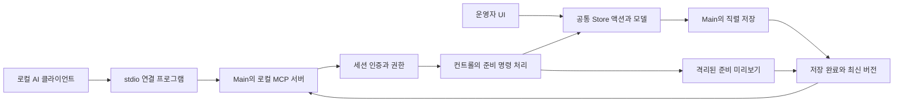

# AI 연결 설계와 계약

2026-10-05 · ADR-011 / REQ-034 / TASK-029 / TC-034 · 구현·로컬 검증 · [실행 기록](../quality/verification-2026-10-05-ai-connection.md)

## 목표와 첫 범위

같은 컴퓨터의 MCP 지원 AI에서 ProPre 자료 검색·조회, 가사/성경 자료 생성·본문/스타일 수정, 진행 순서 구성, 준비 슬라이드 이미지 확인을 수행한다. 기존 자료·현재 선택·송출을 유지하며 결과를 컨트롤 화면과 저장소에 함께 반영한다. 실시간 송출 명령, 외부 파일 읽기/가져오기, 자료 삭제, 웹 공개 서버는 이번 범위에 포함하지 않는다.

설정 → AI 연결 → 조회 또는 자료 준비 허용 → 연결 설정 복사 → AI 클라이언트 등록 → 검색/준비 → 미리보기 → 앱에서 확인하는 흐름이다. 연결은 세션에 한정한다. 앱 재시작 후에는 다시 허용한다. 연결 해제는 새 요청을 즉시 차단하며 이미 저장을 시작한 명령은 완료 결과를 기록한다.

## 구조

Main에 공식 TypeScript MCP SDK를 사용한 stateless Streamable HTTP 서버를 만들고 `127.0.0.1`의 동적 포트에만 바인딩한다. stdio 프로그램은 앱에 포함된 Electron의 Node 모드로 실행해 별도 Node 설치를 요구하지 않는다. 연결 프로그램은 매 요청마다 앱의 세션 파일을 읽어 로컬 인증을 수행한다. AI 클라이언트 설정에는 토큰을 포함하지 않는다.

컨트롤만 편집 상태를 관리하는 기존 경계를 유지한다. 외부 요청은 전용 검증 IPC로 컨트롤 명령 처리기에 전달하고, 기존 자동 저장과 준비 자료 저장 액션으로 적용한다. Main에서 외부 요청을 기존 BrowserWindow로 위장하거나 저장 파일만 고치는 경로는 만들지 않는다. 컨트롤이 닫혔거나 초기화/종료/모달 편집 중이면 변경을 거절하고 복귀 행동을 안내한다.

## 도구와 결과

- `get_app_state`: 준비 가능 여부, 선택/송출 ID, 저장 상태, 소프트웨어 화면 적용 상태.
- `search_presentations`: 제목/본문 검색, 제한과 다음 offset.
- `get_presentation`: ID·revision·제목·전역 스타일·페이지별 텍스트 슬라이드.
- `lookup_bible`: 앱에 포함된 성경 위치 검색. 출처/권리/원문 품질은 기존 미확인 경계를 따른다.
- `create_presentation`: 새 ID로 자료 생성. 현재 선택·출력·작업본 유지.
- `update_presentation`: expectedRevision으로 본문·제목·스타일·추가 슬라이드 일괄 편집. 송출에 영향을 줄 수 있는 현재 자료는 거절.
  - 파트 라벨(A–E, Intro, Inter, TAG)을 수정하면 라벨과 테두리 색상을 함께 저장한다. A1/A2, C1, 반복·페이지 표기도 같은 파트 색을 공유하며, 자료 조회에는 저장된 `labelColor`와 `borderColor`가 포함된다.
- `get_playlist` / `set_playlist`: 순서 조회와 expectedRevision을 사용한 교체. 기존 UI의 순서 대기열과 저장 검증을 공유.
- `get_preview`: 공통 슬라이드 렌더러로 준비 자료의 PNG 반환. 기본 프리셋·현재 종류/스타일의 선택 규칙을 적용하고 effectiveGlobalSlideStyle/styleSource를 함께 반환한다. 송출과 다른 창에서 렌더링하며 실제 장비 적용 증거로 표현하지 않는다. 누락/디코딩 오류는 미리보기 실패로 알리고 렌더링 뒤 미디어를 해제한다.

조회는 제한된 텍스트/ID/스타일만 반환하고 키·개인 파일 경로·미디어 원문·임의 외부 URL을 노출하지 않는다. 변경 결과에는 requestId, 저장 완료 여부, 자료의 최종 revision을 포함한다. 형식 오류·권한 부족·버전 충돌·편집 중·저장 실패·컨트롤 미준비를 기계가 구분할 수 있는 코드로 반환한다.

## 동시 작업과 복구

모든 외부 명령은 직렬 처리한다. 변경 요청에는 클라이언트가 생성한 requestId가 필요하며 같은 세션의 같은 ID·입력 재시도는 기존 실행 결과를 반환한다. 다른 입력으로 ID를 재사용하면 거절한다. 결과를 확정하지 못한 요청도 새 작업으로 재실행하지 않는다. 캐시 한도를 넘으면 새 연결 세션이 필요하다. 세션 재시작 뒤 과거 requestId의 중복 방지는 보장하지 않으며, 재시작 시 재조회 후 새 작업을 판단한다.

열려 있는 모달/입력 중에는 AI 변경을 거절한다. 변경을 적용하는 동안 UI의 편집 입력을 짧게 잠그고 현재 자료·버전을 다시 확인한다. 현재 자료 일괄 수정은 한 번의 Store 변경으로 기존 Undo와 journal·자동 저장을 사용한다. 다른 자료는 원본 revision을 비교한 직렬 저장 후 라이브러리에 반영하며 현재 작업본과 Undo를 유지한다. 순서 변경은 사람/AI 공통 대기열 안에서 원본 참조를 재확인한다.

저장 실패는 완료로 보고하지 않는다. 현재 자료에 적용한 편집본은 기존 복구 journal과 저장 오류/재시도를 사용한다. 다른 자료·순서는 저장 실패 시 화면의 이전 확정 상태를 유지한다. 준비 생성/수정은 자동 송출하거나 자료를 선택하지 않는다.

## 인증과 세션

기본 꺼짐, 조회 권한과 준비 권한 분리, 세션마다 무작위 토큰. 토큰은 Main과 소유자 전용(0600) 연결 파일에서만 사용하며 Renderer·클립보드·백업·검증 로그에는 반환하지 않는다. Host/Origin·Authorization·요청 크기·동시 요청 수를 검사한다. 앱 종료/해제 시 파일과 리스너를 정리한다. 읽기/변경 도구의 MCP annotations는 실제 동작에 맞추고 권한 검사는 서버에서 별도로 수행한다.

## 검증 기준

실제 SDK 클라이언트로 초기화·도구 발견·인자 검증·호출·stdio 연결을 검사한다. 읽기 권한의 변경 거절, 외부 Origin/Host/토큰 거절, 해제/재시작, 중복 요청과 충돌, 사용자 동시 편집/모달/송출 보호, 저장 실패, Undo, 앱 재시작 후 자료/순서 복원, PNG 렌더링과 현재 송출 보존을 검사한다. 기존 전체 검사와 macOS arm64 앱 패키징을 수행한다. 실제 Codex/다른 AI 클라이언트의 도구 선택·계정 연결과 물리 장비 확인은 실제 실행 여부를 구분해 기록한다.

공식 근거: [MCP 서버 구현](https://developers.openai.com/plugins/build/mcp-server), [로컬 MCP 연결](https://learn.chatgpt.com/docs/extend/mcp?surface=cli), [MCP transport](https://modelcontextprotocol.io/specification/2025-11-25/basic/transports).

## 후속 설계인 앱 내부 AI 찬양 준비

2026-10-07 [PDF와 이미지 AI 찬양 준비](ai-song-preparation.md)의 앱 내 실행을 구현했다. REQ-037/TASK-032/TC-037/ADR-014에 연결한다. 기존 외부 MCP 세션 정책을 유지하면서 별도의 내부 작업 세션과 임시 송폼 자료, 콘티 사본을 사용하는 교체/추가의 원자 적용과 재시작 영수증을 제공한다. [사용 안내](../operations/ai-song-preparation.md), [격리 검증](../quality/verification-2026-10-07-ai-song-preparation.md)을 따른다. 실제 모델의 가사·송폼 품질 평가는 대기다.
