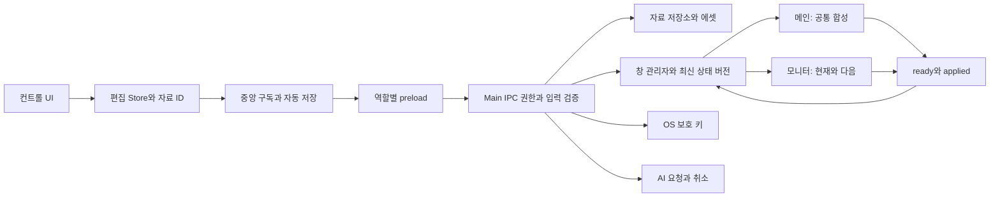

# 시스템 아키텍처

2026-10-04 · 제품 0.1.0 로컬 구현 기준 · [검증](../quality/verification-2026-10-04-implementation.md)

Electron·React·Zustand를 유지하며 저장·창·키·AI의 책임을 Main 서비스로 분리했다. 컨트롤만 편집 Store를 초기화하고 메인/모니터는 자신의 검증된 최신 상태를 수신한다.

## 책임 경계

2026-10-05 로컬 AI 연결: [AI 연결 설계와 계약](ai-connection.md)을 추가했다. Main의 인증된 로컬 MCP → 컨트롤 준비 명령 → 공통 Store/Repository 경로로 자료와 순서를 처리한다. 별도 sandbox 준비 창에서 공통 슬라이드 렌더러를 캡처하며 현재 송출과 선택을 유지한다. AI 연결용 stdio 프로그램은 패키지의 Electron Node 모드로 실행한다.

| 모듈                                                                                                                                                                      | 최종 책임                                                                                 |
| ------------------------------------------------------------------------------------------------------------------------------------------------------------------------- | ----------------------------------------------------------------------------------------- |
| [shared/model](../../shared/model.ts), [schema](../../shared/schema.ts), [contracts](../../shared/contracts.ts)                                                           | 정규화·텍스트 의미·런타임 검증·브릿지 타입                                                |
| [main](../../electron/main.ts)                                                                                                                                            | 앱 경로/단일 인스턴스·IPC 조립·파일 선택·앱/media 프로토콜·종료 저장 보호                 |
| [Repository](../../electron/services/repository.ts)                                                                                                                       | 직렬 트랜잭션·안전 파일 교체·작업본/라이브러리/순서/설정·에셋·백업/복원                   |
| [WindowManager](../../electron/services/windows.ts)                                                                                                                       | 역할 등록·제목·Dock/창 메뉴·장비 변경·최신 전체 snapshot·version·준비/적용/오류·중단 복구 |
| [KeyVault](../../electron/services/security.ts)                                                                                                                           | OS 암호화·legacy 키 변환·키 삭제·상태 공개, 평문 대체 저장 거절                           |
| [AIProfiles](../../electron/services/ai-profiles.ts) / [SongProvider](../../electron/services/song-providers.ts)                                                          | 제공자별 연결과 키 관리, Gemini/OpenAI/Claude 파일·도구 호출                              |
| [runtime](../../src/store/runtime.ts), [persistence](../../src/store/persistence.ts)                                                                                      | 컨트롤 bootstrap·복구 journal·ID별 저장 대기·설정/미디어 저장·중앙 화면 발행              |
| [store](../../src/store.ts), [slices](../../src/store/slices/librarySlice.ts)                                                                                             | 도메인 액션·자료 전환·내용 기반 Undo·순서 참조·레이어/오디오 상태                         |
| [CompositeFrame](../../src/components/CompositeFrame.tsx), [ScaledSlide](../../src/components/ScaledSlide.tsx), [CanvasViewport](../../src/components/CanvasViewport.tsx) | 미리보기/실제 출력 공통 합성·논리 캔버스·요소·폰트 맞춤                                   |

## 자료와 송출

자료 ID·제목·본문·요소·자료별 스타일·revision을 작업본으로 저장한다. 변경된 작업본은 라이브러리의 같은 ID에 자동 저장하며 이전 디스크 상태 5개를 보관한다. 수동 확정 버전과 별도의 장기 편집 분기를 추가한 것은 아니다.

기존 클릭 송출을 유지한다. 활성 슬라이드의 편집·삭제·정렬·Undo는 중앙 발행 구독에서 메인/모니터로 보낸다. 새 자료 전환은 활성 슬라이드를 해제한다. 새로 열거나 생성한 자료는 다른 자료의 ID를 상속하지 않는다.

Main은 화면별 최신 전체 상태와 증가하는 버전을 보관한다. Renderer가 ready를 보내면 캐시를 전달하고 실제 DOM 반영 후 applied를 보고한다. 구버전은 무시한다. 적용 상태는 소프트웨어 화면의 상태이며 실제 HDMI·프로젝터·스피커의 확인을 대신하지 않는다.

## 저장과 복구

작업본 변경은 즉시 로컬 journal에 복구 기록을 남기고 마지막 변경 뒤 400ms에 검증된 Main 저장을 요청한다. ID별 대기열이 자료 전환의 수정본을 보존한다. 저장이 진행 중이어도 새 변경은 대기열의 최신 revision으로 남는다.

Repository는 검증 → 임시 파일 쓰기·fsync → 최종 rename·디렉터리 sync → 메모리 상태 확정 순서를 따른다. 실패하면 현재 디스크/메모리의 이전 확정 상태와 Renderer 편집본을 보존한다. 손상 파일은 별도 보관하고 유효 직전 상태를 읽으며 복구 불가능할 때 덮는 저장을 중지한다.

정상 종료는 열린 편집창을 먼저 반영하고 자료·설정·미디어 기록을 기다린다. 컨트롤만 닫으면 시각 출력은 유지하되 오디오를 중단한다. 화면 프로세스 중단은 창을 다시 만들고 준비 뒤 상태를 재전달한다. 재실행 자료 복원과 마지막 본문/오디오 자동 송출은 구분한다.

## 미디어와 보안

`app://propre`는 앱 번들 안의 파일만, `media://asset/<id>/<name>`는 등록 목록과 실제 미디어 루트 안의 파일만 제공한다. 심볼릭 링크와 경로 탈출을 거절하며 URL 인코딩 이름을 지원한다. 외부 legacy 경로는 임의로 읽지 않고 등록 누락으로 유지해 명시적으로 재연결한다.

모든 창은 sandbox·contextIsolation·webSecurity를 켠다. Main이 실제 BrowserWindow/webContents·main frame·origin을 검사하며 컨트롤만 변경 권한을 갖는다. CSP·권한 요청 거절·탐색/새 창 차단을 적용한다. 키는 Main에서만 사용하고 Renderer에는 configured 여부만 반환한다.

Audio는 컨트롤 루트 한 곳에서 재생한다. 시각 출력 창에 audio를 만들지 않으며 Look의 audio 숨김·전체 중단이 같은 Store 상태를 사용한다. 영상 요소는 muted video로 재생한다.

## 빌드와 지원 범위

화면 역할별 코드와 성경 JSON을 지연 로드한다. 성경 데이터는 한 번 색인하고 장별 조회를 사용하며 UI는 필요한 상태만 구독한다. Renderer JS 총량/개별 청크 700KB 예산을 자동 검사한다. 합성 시험의 시작 시간과 working-set 숫자는 원문 없이 기록한다.

검사·번들·로컬 앱 패키징·공개 릴리즈 명령을 구분한다. 현재 검증 대상은 macOS arm64다. Windows/Linux·모든 장비·서명 설치/갱신·장시간 현장 부하를 확인한 것으로 표시하지 않는다. 자세한 파일 계약은 [데이터·IPC](data-ipc-contracts.md), 정책 근거는 [ADR-008](../governance/decisions.md), 배포 경계는 [릴리즈 기준](../operations/release-checklist.md)에 있다.

변경 전 구조는 [초기 운영 검토](../../OPERATIONS_REVIEW.md)와 [초기 구현 목록의 검토](../review/project-review.md)에 보존한다. 공식 적용 근거: [Electron 보안](https://www.electronjs.org/docs/latest/tutorial/security), [safeStorage](https://www.electronjs.org/docs/latest/api/safe-storage), [protocol](https://www.electronjs.org/docs/latest/api/protocol).
