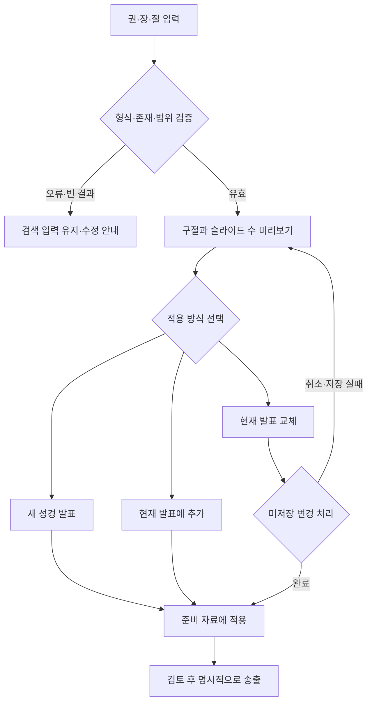

# 사용자 흐름 명세

> 초기 기획·검사 계획을 보존합니다. 실제 구현과 대체 정책은 [구현 결과](../operations/implementation-2026-10-04.md), [ADR-008](../governance/decisions.md), [후속 검증](../quality/verification-2026-10-04-implementation.md)을 기준으로 읽습니다.

작성일: 2026-10-04 · 상태: 제안 · 관련 문서: [기획](product-plan.md), [화면 명세](screen-spec.md), [요구사항](requirements.md)

사용자가 현재 어떤 자료를 편집하고 있는지, 실제로 무엇이 송출되는지, 다음 행동과 실패 후 복귀가 무엇인지 항상 확인할 수 있게 한다. 아래 흐름은 목표 동작이며 현행 앱에서 모두 제공되는 흐름은 아니다.

## FLOW-001 시작·복구

| 단계 | 상태·행동 | 실패·복귀 |
| --- | --- | --- |
| 시작 | 저장된 라이브러리·순서·장비 설정을 검증하고 현재 발표·복구 초안 유무 표시 | 손상 데이터를 덮지 않고 복구 사본 선택·백업 가져오기 제공 |
| 라이브 재개 판단 | 이전 창 설정과 실제 화면 연결 상태 표시; 정책에 따라 대기 또는 재개 선택 | 누락 장비를 명시하고 새 장비를 선택한 뒤 다시 점검 |
| 작업 시작 | 새 발표·기존 발표·복구 초안 중 선택 | 취소하면 현재 상태 유지 |

현재 앱은 이전 활성 플래그에 따라 창을 만들지만, 최신 상태 재전송·복구 초안 흐름은 없다. Stage 활성 복원 시 숨은 창이 생성되는 경로가 있다.

## FLOW-002 발표 만들기·수정·전환

1. 사용자가 기존 발표 또는 `새 발표`를 연다. 미저장 변경이 있으면 저장/폐기/취소를 선택한다.
2. 화면 상단에 발표 제목, 자료 종류, 저장 상태를 표시한다. 새 자료에는 기존 발표 ID를 상속하지 않는다.
3. 텍스트·요소·라벨·배경을 수정한다. 편집 모달의 `적용`과 라이브러리 `저장`을 구분한다.
4. 저장 성공을 확인한 뒤 순서에 추가한다. 실패하면 내용과 위치를 유지하고 재시도한다.
5. 다른 발표로 이동해도 라이브 스냅샷 처리 정책을 따르며, 순서를 돌아왔을 때 현재 발표·선택 위치를 확인할 수 있다.

관련: REQ-001, REQ-002, REQ-004, REQ-005, REQ-009. 현재의 인라인·일괄 편집은 `content`만 변경할 수 있어 요소 텍스트와 다를 수 있다.

## FLOW-003 성경 검색·적용

검색만으로 라이브러리 발표의 원본을 수정하지 않는다. 잘못된 입력은 해석 후보나 올바른 입력 예를 보여주고 현재 발표·송출을 유지한다. `요12:1`, `시119:1`, `요1 2:1`, 역방향 범위와 실제 데이터에 없는 장·절을 별도로 검사한다.

현재 구현: 왼쪽 `Bible` 탭 검색은 새 ID의 성경 자료를 열며 이전 자료를 보존한다. 찬양에 삽입할 때는 아래 FLOW-008을 사용한다. 위 초기 비교안의 별도 교체 선택 UI를 구현했다는 뜻은 아니다.

## FLOW-004 파일 가져오기·내보내기

1. 파일 선택 → 형식·버전·중첩 필드 검증 → 제목·발표 수·미디어 누락·ID 충돌 미리보기.
2. 단일 발표는 새 발표/추가/명시적 교체를 선택한다. 라이브러리 병합은 충돌을 새 복사본으로 받을지 교체할지 결정한다.
3. 취소·검증 실패·저장 실패 시 기존 자료를 보존한다. 병합 결과는 성공·실패·건너뜀을 구분한다.
4. 내보내기는 포함 범위(발표, 스타일, 미디어, 순서)를 표시한다. 다른 컴퓨터로 이동할 목적이라면 미디어 포함 여부와 누락을 확인한다.
5. 새 사용자 데이터 환경에서 재열기를 검사하고 기존 파일을 복원용으로 보존한다.

현재 `.ppros`는 JSON 파일이며 미디어 파일을 함께 담는 이동형 패키지가 아니다.

## FLOW-005 리허설·현장 진행

| 상황 | 목표 행동 | 상태·복귀 |
| --- | --- | --- |
| 장비 준비 | Main·Stage 장비 선택 후 테스트 화면과 수신 준비 확인 | 장비명·해상도·준비/대기/오류를 계속 표시 |
| 슬라이드 진행 | 일반 클릭·진행 키로 명시적 송출; 다중 선택·편집은 구분 | 실제 송출 슬라이드와 선택한 슬라이드를 서로 다른 문구로 표시 |
| 라이브 편집 적용 | 정책상 적용한 편집만 송출 버전을 갱신 | Output·Stage·미리보기 모두 동일 상태 확인 |
| 자막·고정 안내 | 표시 범위를 점검 후 송출 | 레이어별 활성 상태와 지우기 제공 |
| 긴급 중단 | 정의한 전체 화면·오디오 중단 실행 | 중단 여부를 표시; 원본 자료를 삭제하지 않고 재개는 운영자 행동으로 수행 |
| 장비 재연결 | 누락 알림 → 장비 재선택 → 최신 상태 확인 → 재개 | 임의 장비로 조용히 옮겨진 화면을 활성으로 오인하지 않게 함 |

관련: REQ-008, REQ-010~014, REQ-023. 실제 다중 디스플레이 리허설은 이번 검토에서 수행하지 않았다.

## FLOW-006 AI 이미지 추출

이미지 선택 → 외부 전송 안내·키 상태 확인 → 추출 실행 → 진행·취소 → 결과 텍스트 검토 → 적용 대상 발표와 변경 개수 확인 → 적용 → 별도 저장 순으로 진행한다. 오류 시 수동 입력 또는 원본 편집으로 돌아온다.

발표를 전환했거나 요청을 취소한 뒤 늦게 도착한 결과는 자동 적용하지 않는다. API 키나 모델 호출 성공은 이번에 확인하지 않았다. AI 결과의 정확성과 제공자의 자료 처리 조건도 별도 확인 대상이다.

## FLOW-007 종료·재사용

송출·오디오 중단 → 미저장 자료 저장 또는 취소 → 정의된 범위 백업 → 백업 결과 확인 → 창 종료 순으로 진행한다. 다음 실행 시 자료·순서·설정을 검증하고 복구 초안을 확인한다. 자료 복원과 라이브 재개는 별도 행동으로 관리한다.

## FLOW-008 찬양 자료에 성경 구절 추가

2026-10-05 구현 기준 · REQ-035 / TASK-030 / TC-035 / ADR-012

1. 찬양 자료를 열고 오른쪽 아래 `성경 구절 추가`를 누른다. 대화상자에서 대상 자료 제목을 확인한다.
2. `요 3:16`, `시편 23:1-6`, `창 1`처럼 입력해 검색한다. 성경 책 이름·약칭과 장·절/범위를 지원하며 원본에서 합쳐진 절은 전체 범위로 검색한다.
3. 본문·구절을 확인하고 필요한 항목만 선택한다. 검색 결과는 모두 선택된 상태로 시작하며 `전체 선택`으로 해제/선택할 수 있다.
4. 맨 앞·맨 뒤·특정 슬라이드 뒤를 선택한다. 다중 선택이 있으면 목록 순서상 마지막 선택 슬라이드 뒤를 기본값으로, 선택이 없으면 맨 뒤를 사용한다.
5. `N개 구절 추가`를 누르면 결과 순서대로 현재 자료에 말씀 슬라이드를 삽입하고 자동 저장한다. 새 슬라이드를 선택 표시하며 현재 라이브 본문·스타일·배경은 유지한다. 모니터의 다음 본문은 삽입된 순서로 갱신한다.
6. 삽입된 슬라이드 클릭으로 송출하거나 더블클릭으로 본문을 편집한다. 찬양↔성경 기본 프리셋 적용은 기존 정책을 따르고 구절 표기는 별도 출처 스타일을 유지한다. 한 번의 Undo/Redo로 일괄 추가를 되돌리거나 다시 적용한다.

검색 입력을 바꾸면 이전 결과·선택을 비우며 늦게 도착한 이전 검색 결과를 무시한다. 오류·선택 없음은 추가할 수 없고, 취소·닫기·Escape는 자료를 바꾸지 않는다. 검색 중 자료가 바뀌거나 지정 위치가 삭제되면 삽입을 거절하고 대상/위치를 다시 확인하도록 안내한다. 검색 모달의 방향키·숫자·Space·F2는 송출을 조작하지 않으며 Tab은 모달 안에서 이동한다.

## FLOW-009 AI에서 자료 준비

2026-10-05 구현 기준 · REQ-034 / TASK-029 / TC-034 / ADR-011

1. 설정 → 시스템 환경 설정 열기 → AI 연결에서 조회/준비 범위를 선택하고 허용한다.
2. 연결 설정을 AI 클라이언트에 추가해 연결됨을 확인하고 설정창을 닫는다.
3. AI에서 앱 상태와 자료를 조회한다. 변경은 최신 revision을 확인한 뒤 요청한다.
4. 새 자료 생성·본문/스타일/추가 슬라이드 수정·진행 순서 구성을 수행한다. 현재 선택/송출은 유지하고 운영자 편집·현재 송출 자료 변경은 거절한다.
5. 준비 PNG로 확인하고 앱의 자료 목록에서 검토한다. 직접 송출은 기존 운영자가 수행한다.
6. 저장 실패는 적용 여부를 구분한다. 현재 편집본은 앱 저장 재시도/내보내기, 다른 자료/순서는 이전 상태 확인 후 새 요청을 사용한다.
7. 연결 해제로 이후 요청을 차단한다. 재시작/재허용 뒤 클라이언트를 재연결하고 자료를 재조회한다.

설치 위치 변경·연결 대기·권한 부족·버전 충돌·결과 불명·미리보기 실패의 복귀는 [AI 사용 안내](../operations/ai-connection.md)를 따른다. 같은 세션의 동일 requestId 결과 재사용은 앱 재시작을 넘어 유지되는 보장이 아니다.

## FLOW-010 플레이리스트 파일 저장·불러오기

2026-10-05 구현 기준 · REQ-036 / TASK-031 / TC-036 / ADR-013

현재 순서 준비 → 플레이리스트의 파일 저장 → 이름/위치 선택 → 저장 완료. 다른 콘티는 파일 불러오기 → 파일 선택 → 순서 확인 → 불러오기 → 해당 곡을 찬양 목록에 등록하고 현재 순서 교체 → 필요한 곡 선택/진행. 반복 순서는 그대로 복원하고 동일 내용은 재사용, 다른 내용은 새 자료로 보관한다. 현재 작업 곡과 송출은 유지한다. 취소/오류는 기존 목록으로 복귀하며 전체 저장 실패는 일부 곡·순서를 적용하지 않는다. 빈 순서는 저장 불가. [운영 안내](../operations/playlist-files.md)를 따른다.

## FLOW-011 파일로 AI 찬양과 플레이리스트 준비

2026-10-07 구현·격리 검증 완료 / 실제 API 평가 대기 · REQ-037 / TASK-032 / TC-037 / ADR-014

1. 플레이리스트의 **파일로 찬양 준비**에서 PDF/이미지를 넣고 파일 순서를 확인한다.
2. 등록한 AI와 모델, **기존 플레이리스트를 새로 구성** 또는 **기존 플레이리스트에 추가**, 검토 후 적용 또는 생성 후 바로 적용을 선택한다. 곡별 송폼 지시는 선택 입력한다.
3. **AI로 찬양 준비**를 누르면 선택 제공자에 파일을 보내 곡·파트·반복을 분석하고 MCP로 임시 슬라이드와 곡 순서를 구성한다. 분석 중 진행 단계·취소·작업으로 돌아오기를 제공한다.
4. 검토 화면에서 원문·가사·송폼·순서·실제 미리보기·교체/추가 결과를 확인한다. 자동 적용은 확인 항목/충돌이 없을 때만 진행한다. 불명확한 가사/반복은 수정하고 다시 확인한다.
5. 곡·순서·저장 영수증을 한 번에 적용한다. 기존 자료를 먼저 삭제하거나 플레이리스트를 먼저 비우지 않는다. 현재 자료·편집본·Undo·송출을 유지한다.
6. 저장 완료 후 플레이리스트 보기/준비한 곡 열기/이번 순서 적용 되돌리기를 제공한다. 새 곡 송출은 기존 운영자 행동을 따른다.

실패 시 성공 초안을 보존하고 실패 파일만 선택해 다시 분석하거나 해당 곡을 수동 수정한다. 다른 AI로 바꿔 재분석할 때 전송할 자료와 새 제공자를 확인한다. 순서 변경은 최신 차이를 검토한 뒤 적용하며, 응답 유실/재시작은 영수증으로 중복 없이 복구한다. 자세한 화면·오류·권한 계약은 [AI 찬양 준비 설계](../engineering/ai-song-preparation.md)를 따른다.

2026-10-07 구현 흐름: 새 찬양은 목록에 자동 등록한다. 기존 원곡은 콘티별 사본과 별개로 유지하며 원곡 갱신은 검토에서만 선택한다. [사용 안내](../operations/ai-song-preparation.md), [검증](../quality/verification-2026-10-07-ai-song-preparation.md)을 따른다.

## FLOW-012 예배별 콘티 보관과 원곡 반영

2026-10-06 구현 기준 · REQ-038 / TASK-033 / TC-038 / ADR-015

플레이리스트 → 콘티 보관함 → 이름/선택 날짜 → 현재 순서 복사 또는 빈 콘티 생성 → 곡 선택/편집 → 사본 자동 저장. 지난 콘티 → 복제 → 새 이름/날짜 → 새 사본 편집. 보관한 콘티 열기는 현재 편집/송출을 유지하며 해당 곡 클릭으로 기존 선택 흐름을 따른다. 원곡 반영은 소속 문구 → 원곡에 반영 → 본문 확인 → 버전 비교 → 원곡만 갱신이며 다른 콘티는 유지한다. 삭제는 휴지통으로 이동하고 복원한다. 취소·충돌·저장 실패는 재시도할 수 있으며 기존 데이터에 일부 적용하지 않는다.
